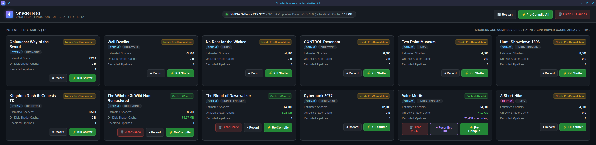

<p align="center"></p>

<h1 align="center">Shaderless</h1>

> **Kill shader compilation stutter in your Proton games on Linux.**
> Compiles your games' DirectX 12 pipelines into the driver's cache *before* you play.

**Unofficial Linux port of [SCSKiller](https://github.com/BlueHeisenberg/SCSKiller)** (Windows), by the SCSKiller authors.
Shaderless is not affiliated with or endorsed by the SCSKiller project. Bugs in this port are ours. Please don't report them to SCSKiller.

> [!WARNING]
> **Beta.** Tested on **NVIDIA** only. AMD should work, but nobody has confirmed it yet (0.1.1 includes a Wayland/AMD startup fix that is also unconfirmed). [**AMD testers wanted!**](#-amd-testers-wanted)

<p align="center"></p>

---

## What it does

Modern games (especially Unreal Engine 5) compile shaders while you play. Every new effect or area can freeze the
game for a moment. Shaderless compiles them ahead of time, through **the same Proton / vkd3d-proton your game
uses**, so the game finds them already compiled.

- Finds your games in **Steam**, **Heroic** (Epic games) and **Lutris** (Epic Store games and games in their own folder). See [Library support](#library-support) for what's tested
- Reads the game's own shader archives using SCSKiller's engine readers (Unreal, Unity, FromSoftware, RE Engine, REDengine, Dagor, Northlight, …)
- Compiles everything with all CPU cores, inside the game's own Proton prefix and Proton version
- **⏺ Record mode:** learns exactly what your game asks for while you play, then compiles exactly that

## Library support

| Launcher | Status |
|---|---|
| **Steam** | Works. Tested on this port's main test machine. |
| **Heroic** | **Epic games:** found (checked with one game); compiling a Heroic game hasn't been tested much. **GOG / Amazon:** not supported yet. |
| **Lutris** | **Epic Games Store games** (installed through Lutris): found and compiled (one game, End of Abyss, Unreal Engine 5). The game uses the compiled cache: pipelines it had to compile itself dropped from 94% to 7% (one game, see [test results](#test-results-our-own-2-games)). **Games in their own folder:** implemented, but not tested on a real library. **GOG / other launchers in a Wine prefix:** not found yet. |

If your games don't show up, please [open an issue](../../issues) with the launcher and where the game lives.

### End of Abyss (Epic Games Store, run through Lutris)

*End of Abyss (Unreal Engine 5, UMU-Proton 10.0-4 through Lutris) · RTX 3070 · NVIDIA 615.78.08 · CachyOS.
Same machine as above. Timings measured by the recorder itself. A pipeline create over 3 ms counts as "had to compile", the rule SCSKiller uses.*

| | Session 1: no cache | Session 2: after Record + Re-Compile | Session 3: after 2nd Re-Compile, plus a new area |
|---|---|---|---|
| Pipelines the game had to compile | 94.4% | **6.7%** | **2.1%** |
| Typical pipeline create time | 44 ms | **0.28 ms** | **0.25 ms** |
| Slowest single create | 5.9 s | **30 ms** | 289 ms (entering the new area) |
| Compiles after the first minute of play | 213 | **0** | 60 (58 of them in one 30-second burst on entering the new area) |

Sessions 2 and 3 repeat the route of session 1 (about 7,250 pipeline creates each, so the comparison is like for like). Session 3 then goes into an area that session 1 and 2 never visited, and that is where the remaining hitch is. One game, one route, no frame-time measurements.

> **Caveat:** the game also writes its own shader cache while you play, and that cache was still in place for sessions 2 and 3. So part of the improvement may come from the game's own cache from the previous session, not only from Shaderless. We have not yet run a test that separates the two, and the Valor Mortis table above has the same limit.

## Install

### Option 1: Pre-built Release (No .NET SDK needed)

Needs Steam with **Proton** (Heroic / Lutris libraries are partly supported, see [Library support](#library-support)), and WebKitGTK (`webkit2gtk-4.1`) for the window.

Download **`Shaderless-v0.1.1-beta-linux-x64.tar.gz`** from [**Releases**](https://github.com/cyberps96/Shaderless/releases/latest):

```bash
tar -xzf Shaderless-v0.1.1-beta-linux-x64.tar.gz
cd Shaderless-v0.1.1-beta-linux-x64
./run-gui.sh          # launch the app
./install-desktop.sh  # optional: adds Shaderless (with its icon) to your app menu and desktop
```

### Option 2: Run from Source

Requirements: **.NET 10 SDK**, Steam with **Proton** (tested with Proton-CachyOS), WebKitGTK (for the GUI).

```bash
git clone https://github.com/cyberps96/Shaderless.git
cd Shaderless
./run-gui.sh          # the app
./install-desktop.sh  # optional: adds Shaderless (with its icon) to your app menu and desktop
./run-cli.sh status   # or the command line: status, list, compile "<game>", compile-all, clear "<game>", clear-all
```

The two Windows-side helpers (`d3d12.dll` recorder, `scskiller_warm.exe` warmer) are prebuilt in
`src/SCSKiller.Linux.Core/Native/`. To rebuild them from source you need mingw-w64, then run `./build-native.sh`.

## How to use it

1. Start Shaderless and click **⏺ Record** on your game.
2. Play for **5–10 minutes** and close the game. The first session still stutters, because that's the session being recorded.
3. Click **⚡ Compile** / **Re-Compile**.
4. Play. What you recorded is now smooth. Leave Record on: each session adds anything new, and the next Re-Compile covers it.

After a GPU driver or game update, just click **Re-Compile**. Your recording is kept.

### Why Record matters more on Linux than on Windows

On Windows with NVIDIA, a shader compiled once works with any pipeline state. On Linux, vkd3d-proton turns every
DirectX 12 pipeline into a Vulkan pipeline that includes its **full state** (vertex layout, render-target formats,
blend mode…). Without a recording, Shaderless has to guess that state, and wrong guesses are wasted. The recording
teaches it the real state, and Shaderless also applies what it learns to shaders you haven't reached yet.

> **Known limit:** areas you've never visited can still hitch the first time (on Valor Mortis it was short, about one
> burst while new content streamed in). Keep Record on and Re-Compile, and they get covered.

## Test results (our own, 2 games)

### Valor Mortis (Steam)

*Valor Mortis (Unreal Engine 5, Proton) · RTX 3070 · NVIDIA 615.78.08 · CachyOS · ~10 min per session.
Timings measured by the recorder itself.*

| | No matching cache | After Record + Re-Compile | After 2nd round |
|---|---|---|---|
| Pipelines the game had to compile | 48.9% | **6.0%** | 8.7% (new areas visited) |
| Typical pipeline create time | 2.83 ms | **0.29 ms** | 0.35 ms |
| Compile time spent during loading screens | 170 s | 112 s | **56 s** |
| New ray tracing pipelines at load | — | 315 | **11** |

## If recording doesn't start

After launching the game with Record on, a `scskiller.log` should appear next to the game's real exe. For Unreal games
that's `<Game>/Binaries/Win64/`, not the top folder. If it doesn't appear, add this to the game's Steam launch options:

```
WINEDLLOVERRIDES="d3d12=n,b" %command%
```

## Troubleshooting

- **The window doesn't open / is blank (Wayland, AMD or NVIDIA):** start it with `./run-gui.sh` (it sets `GDK_BACKEND=x11` and turns off WebKit's DMA-BUF renderer). Don't launch the binary directly.
- **`webkit2gtk` / `libwebkit2gtk-4.1` not found:** install it (Arch/CachyOS: `webkit2gtk-4.1`, Debian/Ubuntu: `libwebkit2gtk-4.1-0`, Fedora: `webkit2gtk4.1`).
- **No games listed:** Shaderless reads Steam, Heroic (Epic) and Lutris libraries from their default folders. Lutris games that run through a launcher other than the Epic Games Store (for example GOG Galaxy) aren't found yet. Run `./run-cli.sh list` to see what it finds.
- **Which version am I on?** It's shown in the app header, or run `./run-cli.sh --version`. Please include it in bug reports.
- **Games with anti-cheat:** see [Anti-cheat games](#anti-cheat-games) below.

## Anti-cheat games

> [!WARNING]
> Games with anti-cheat (EasyAntiCheat, BattlEye, …) can ban accounts over unknown files in their folder.
> Shaderless is careful here, but **we can't guarantee anything on your behalf. Use it at your own risk.**

- **Record mode is refused.** Shaderless looks for anti-cheat files in the game's folder. If it finds one, it will not install the recorder.
- **Compiling still works.** It shows a notice, then compiles outside the game, in the game's Proton prefix. It does not copy its cache file into the game's folder. *(This part hasn't been tested on a real anti-cheat game yet.)*
- **Detection isn't perfect.** It's based on files in the game's folder, so an unusual anti-cheat could be missed. If in doubt, don't use Record on online games.
- The Windows SCSKiller handles anti-cheat in more detail (per-game statuses, an opt-in offline mode). Shaderless doesn't have those yet.

## Safety

- **Record mode** adds a few small files next to the game's exe (`d3d12.dll`, `scskiller.ini`, `scskiller.armed`, keys, and the recording and log it produces). It refuses to replace another mod's `d3d12.dll`.
- It only records **which pipelines the game creates**: no input, no network.
- Clicking **Recording (on)** again removes the recorder and every file it added.
- For games **without** anti-cheat, a finished compile also copies a `vkd3d-proton.cache` file next to the game's exe.

## 🔴 AMD testers wanted

Shaderless switches to AMD mode automatically (Mesa / RADV), but it hasn't been tested on AMD yet. If you have an AMD
GPU, please try **Record → play → Re-Compile → play** on any DX12 Proton game and
[open an **AMD test report** issue](../../issues/new?template=amd-test-report.yml). The most useful part is **where the
shader cache was written** and how big it is. Check:

- `~/.cache/mesa_shader_cache*` (or `$MESA_SHADER_CACHE_DIR`)
- `~/.local/share/Steam/steamapps/shadercache/<appid>/`
- `~/.local/share/Steam/steamapps/compatdata/<appid>/` (look for `vkd3d-proton.cache*`)

## Differences from SCSKiller (Windows)

Done: game discovery, all engine readers, planning, compile through Proton, Record mode.
Not yet: automatic recording of all games, automatic compile after a game closes, community recordings, compile queue,
driver-update detection, and some recorder extras (frame-time logging, recording alongside ReShade/other `d3d12.dll`
mods, NVAPI state).

## 💜 Support

Shaderless is free and stays free: no paid features.

If it saved your games from stutter and you'd like to support the Linux port:

| Currency | Network | Address |
|---|---|---|
| Bitcoin (BTC) | Bitcoin (SegWit) | `bc1q3hefk7fswsgq5zxed05vy0v4rt2qks90en5mjp` |
| Solana (SOL) | Solana | `cQiSktSJbtLNEpZZwsKw8NxEpdXeLKTKXDnCccS6f9g` |
| Litecoin (LTC) | Litecoin | `LLdkGKhNdWJwRjHm4RERn9qnEuCzRBAnZK` |
| USDT (Tether) | **Tron (TRC-20) only** | `TStfK2yMPrV5xzXffGaaoMd2CU6RDHTvbg` |

> Send only the listed coin on the listed network. For example, USDT sent on Ethereum (ERC-20) to the Tron address is lost.

The core of this tool is SCSKiller's work. Please consider supporting the original author too:
**[SCSKiller on Patreon](https://www.patreon.com/SCSKiller)**.

## License

GPL-3.0-or-later, with the additional permission in [LICENSE-EXCEPTION.txt](LICENSE-EXCEPTION.txt), the same as SCSKiller.
Copyright (C) 2026 The SCSKiller authors; Linux port changes Copyright (C) 2026 the Shaderless contributors.
This is a modified version of SCSKiller: the Linux app, game sources, Proton integration, warmer and recorder ports live in
`src/`; the parts of SCSKiller it uses (SCSKiller.Core + one warmer file, with a small Linux patch) are in [`upstream/`](upstream/README.md). Third-party components: [THIRD-PARTY-NOTICES.md](THIRD-PARTY-NOTICES.md).

Not affiliated with any GPU maker, engine maker or game publisher. All product names are trademarks of their owners.
