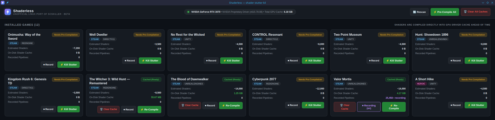

<p align="center"></p>

<h1 align="center">Shaderless</h1>

> **Kill shader compilation stutter in your Proton games on Linux.**
> Compiles your games' DirectX 12 pipelines and DirectX 11 shaders into the driver's cache *before* you play.

**Unofficial Linux port of [SCSKiller](https://github.com/BlueHeisenberg/SCSKiller)** (Windows), by the SCSKiller authors.
Shaderless is not affiliated with or endorsed by the SCSKiller project. Bugs in this port are ours. Please don't report them to SCSKiller.

> [!WARNING]
> **Beta.** Compiling is tested on **NVIDIA** only. On **AMD** the app opens and runs (a tester confirmed it), but nobody has confirmed a compile result there yet. [**AMD testers wanted!**](#-amd-testers-wanted)

<p align="center"></p>

---

## What it does

Modern games (especially Unreal Engine 5) compile shaders while you play. Every new effect or area can freeze the
game for a moment. Shaderless compiles them ahead of time, through **the same Proton / vkd3d-proton / DXVK your game
uses**, so the game finds them already compiled.

- Finds your games in **Steam**, **Heroic** (Epic games) and **Lutris** (Epic Store games, Ubisoft Connect games, and games in their own folder), and lets you launch them straight from the app (**▶ Play**). See [Library support](#library-support) for what's tested
- Reads the game's own shader archives using SCSKiller's engine readers (Unreal, Unity, FromSoftware, RE Engine, REDengine, Dagor, Northlight, Ubisoft Anvil `.forge`, …)
- Compiles everything with all CPU cores, inside the game's own Proton prefix, Proton version, and shader-affecting launch options
- **⏺ Record mode & 🎯 Recorded Only (DirectX 12):** learns the exact pipelines your game asks for while you play, then lets you compile **only** those recorded pipelines in ~1–2 minutes (**🎯 Recorded Only**) or the full archive + recorded plan (**⚡ Kill Stutter**)

## Library support

| Launcher | Status |
|---|---|
| **Steam** | Works. Tested on this port's main test machine. |
| **Heroic** | **Epic games:** found, compiled in the game's own prefix, and the cache installed where the game reads it. Tested on both 64-bit DirectX 12 (**Borderlands 4**, Unreal Engine 5.5: pipelines the game had to compile dropped from 93.6% to 15.6% and typical create time from 131 ms to 0.36 ms; see [test results](#test-results-our-own-6-games)) and DirectX 11 (**A Short Hike**, where all 2,402 shaders compile cleanly; note that 32-bit games use a separate 32-bit NVIDIA driver subfolder, see the DirectX 11 note below). **GOG / Amazon:** not supported yet. |
| **Lutris** | **Epic Games Store games** (installed through Lutris): found and compiled (two games, End of Abyss and Phantom Blade Zero, both Unreal Engine 5). The game uses the compiled cache: pipelines it had to compile itself dropped from 94% to 7% on End of Abyss and from 85% to 7% on Phantom Blade Zero (see [test results](#test-results-our-own-6-games)). **Ubisoft Connect games** (both installed inside a Lutris Ubisoft Connect prefix and added as individual Ubisoft cards): found, compiled in the game's Proton prefix, and mirrored across Linux case-sensitive runtime `.exe` variants (tested on *Assassin's Creed Shadows*, Anvil `.forge`). **Games added by their exe** (for example a DRM-free copy): found, compiled, and the cache installed where the game reads it, checked with the game's real settings (one game, Proton-CachyOS; no stutter measurements). **Games from a Lutris installer script:** implemented, not tested. **GOG / other launchers in a Wine prefix:** not found yet. |
| **Flatpak versions** of Steam, Heroic and Lutris | **Works.** Discovers games installed in Flatpak Steam (`~/.var/app/com.valvesoftware.Steam`), Flatpak Heroic (`~/.var/app/com.heroicgameslauncher.hgl`) and Flatpak Lutris (`~/.var/app/net.lutris.Lutris`), compiles them in their own prefix and Proton runtime, and links the compiled cache into each Flatpak app's sandbox cache folder. Tested on all 3 Flatpak launchers (*The Witcher 3*, *A Short Hike*, *End of Abyss*). |

**DirectX 11 games:** Supported for **64-bit** DirectX 11 games across all supported engines (Unreal, Unity, FromSoftware, RE Engine, REDengine, Dagor, Northlight, …). Shaderless extracts every DirectX 11 (SM4/SM5 DXBC) shader directly from the game's files (no recording needed) and compiles them through Proton's DXVK into your GPU driver's Vulkan cache. **Known limit for 32-bit (`x86`) games:** our warmer binary (`shaderless_warm.exe`) is 64-bit (`x86_64`), so on NVIDIA it writes into the 64-bit `libnvidia-glcore.so` subfolder inside `GLCache`, whereas a 32-bit game (such as *A Short Hike*) loads 32-bit `libnvidia-glcore.so` and uses a separate 32-bit subfolder inside `GLCache`.

**AMD (Mesa) and Lutris:** the step that installs the compiled cache where a Lutris game reads it is only done for the NVIDIA cache and the vkd3d-proton cache. Mesa's cache isn't handled yet, so AMD users on Lutris may not see the full effect. We have no AMD machine to test on.

If your games don't show up, please [open an issue](../../issues) with the launcher and where the game lives.

## Install

### Option 1: Pre-built Release (No .NET SDK needed)

Needs Steam with **Proton** (Heroic / Lutris libraries are partly supported, see [Library support](#library-support)), and WebKitGTK (`webkit2gtk-4.1`) for the window.

Download **`Shaderless-v0.3.0-beta-linux-x64.tar.gz`** from [**Releases**](https://github.com/cyberps96/Shaderless/releases/latest):

```bash
tar -xzf Shaderless-v0.3.0-beta-linux-x64.tar.gz
cd Shaderless-v0.3.0-beta-linux-x64
./run-gui.sh          # launch the app
./install-desktop.sh  # optional: adds Shaderless (with its icon) to your app menu and desktop
```

### Option 2: Run from Source

Requirements: **.NET 10 SDK**, Steam with **Proton** (tested with Proton-CachyOS), WebKitGTK (for the GUI).

```bash
git clone https://github.com/cyberps96/Shaderless.git
cd Shaderless
./run-gui.sh          # the app
./install-desktop.sh  # optional: adds Shaderless (with its icon) to your app menu and desktop
./run-cli.sh status   # or the command line: status, list, diagnose, logs, settings, play "<game>", record "<game>", compile "<game>" [--recorded-only], compile-all, clear "<game>", clear-all
```

The three Windows-side helpers (`d3d12.dll` recorder, `dxgi.dll` Streamline companion loader, `shaderless_warm.exe` warmer) are prebuilt in
`src/Shaderless.Core/Native/`. To rebuild them from source you need mingw-w64, then run `./build-native.sh`.

## How to use it

1. Start Shaderless and click **⏺ Record** on your game.
2. Click **▶ Play** right on the card (or start the game from Steam / Heroic / Lutris), play for **5–10 minutes**, and close the game. The first session still stutters, because that's the session being recorded.
3. Click **⚡ Kill Stutter / Re-Compile** (full archive + recorded compile) — **or** click **🎯 Recorded Only** (`./run-cli.sh compile "<game>" --recorded-only`) to skip scanning huge game archives and compile **only** your recorded gameplay pipelines in ~1–2 minutes.
4. Play. What you recorded is now smooth. Leave Record on: each session adds anything new, and the next **Re-Compile** skips re-scanning unchanged game archives and compiles **only** the newly recorded pipelines in seconds.

- **🎯 Recorded Only vs ⚡ Kill Stutter / Re-Compile:** As soon as a game has recorded pipelines (`Recorded Pipelines > 0`), **🎯 Recorded Only** appears on the card. On huge 150–200 GB Unreal Engine 5 games (like *Borderlands 4*), a full archive plan generates `500,000+` extra permutations (~30–60 min first build), whereas **🎯 Recorded Only** compiles strictly the `30,000–40,000` pipelines your game actually used (~1–2 min — great for a fast first build or quick rebuild after a GPU driver / Proton update). Clicking **⚡ Re-Compile** later upgrades a Recorded-Only or **Partial** cache to the full archive plan while keeping your existing compiled cache.

- **Compiling before you've played (no recording yet):** allowed when the engine's shaders can be read from disk, and it helps partly (on Phantom Blade Zero the first launch's shader bar went from about 30 to 8.5 minutes). Games whose DirectX 12 pipelines only exist at runtime (such as RE Engine, Unity DX12, Northlight, or encrypted archives without a key) are automatically badged **Needs Recording** upfront so you know to record first. When a file-only compile covers global shaders or guessed state without a recording yet, the card shows a **Partial** note until you record and Re-Compile; that Re-Compile **adds to** the cache instead of deleting it.
- **⚙️ Settings:** Open **⚙️ Settings** in the header (or run `./run-cli.sh settings`) to optionally turn on **Record all games automatically** (OFF by default), **Compile automatically after a game closes** (OFF by default), or adjust **Max shader cache size** (10 GB default, up to 500 GB — raises GPU driver cache limits and automatically splits large NVIDIA caches into `<1.85 GB` multi-part files so UE5 games never truncate at 2 GB or evict older shaders).
- **Stale detection & per-game launch options:** Shaderless forwards shader-affecting launch options from Steam, Heroic, Lutris, and Goverlay `bgmod` (such as `VKD3D_CONFIG`, `VKD3D_DISABLE_EXTENSIONS`, `PROTON_VKD3D_LOWLATENCY`, `DXVK_CONFIG`, `RADV_PERFTEST`) into the compiler so the warmed cache matches how the game runs. After a GPU driver update, Proton update, game patch, or shader-affecting launch-option change, affected caches are marked **Stale** (`driver updated`, `Proton updated`, `game updated`, or `launch options changed`), while runtime-only flags (`MANGOHUD`, `gamemoderun`, `PROTON_ENABLE_NVAPI`, `single_queue`, FPS caps) are ignored.
- **❓ Guide, update notice & crash log:** Click **❓ Guide** in the header anytime to re-open the workflow overview. On startup, Shaderless checks GitHub Releases in the background to let you know if a newer release is out (no self-updater), and automatically records crash/error details in `~/.local/share/shaderless/crash.log` (accessible from **⚙️ Settings**, **🩺 Diagnose**, or `./run-cli.sh logs`).

### Why Record matters more on Linux than on Windows

On Windows with NVIDIA, a shader compiled once works with any pipeline state. On Linux, vkd3d-proton turns every
DirectX 12 pipeline into a Vulkan pipeline that includes its **full state** (vertex layout, render-target formats,
blend mode…). Without a recording, Shaderless has to guess that state, and on an engine version no game has confirmed
yet it also has to guess how the game connects its shaders (the root signatures). A guessed compile still helps, but
only partly. The recording teaches it the real state, and Shaderless also applies what it learns to shaders you haven't
reached yet.

> **Known limit:** areas you've never visited can still hitch the first time (on Valor Mortis it was short, about one
> burst while new content streamed in). Keep Record on and Re-Compile, and they get covered.

## Test results (our own, 6 games)

*All 6 games on the same machine: RTX 3070 · NVIDIA 615.78.08 · CachyOS. Timings measured by the recorder itself.
"Had to compile" means a pipeline create over 3 ms, the rule SCSKiller uses.*

| Game | Session | Had to compile | Typical create time | Slowest create | Compile time during loading screens |
|---|---|---|---|---|---|
| **Borderlands 4** (Epic Games Store, through Heroic) | 1: no cache (menu shader screen) | 93.6% | 131 ms | 8.1 s | ~10 min |
| | 2: after 1st Re-Compile (entering gameplay) | 54.5% | 3.3 ms | 3.0 s | ~2 min |
| | 3: after 2nd Re-Compile (gameplay) | **15.6%** | **0.36 ms** | **558 ms** | **24 s** |
| **The Blood of Dawnwalker** (Steam, Proton) | 1: no cache | 85.5% | 37 ms | 3.8 s | 205 s |
| | 2: after Record + Re-Compile | **1.1%** | **0.24 ms** | **270 ms** | **30 s** |
| **Valor Mortis** (Steam, Proton) | 1: no matching cache | 48.9% | 2.83 ms | — | 170 s |
| | 2: after Record + Re-Compile | **6.0%** | **0.29 ms** | — | 112 s |
| | 3: after 2nd round (new areas visited) | 8.7% | 0.35 ms | — | **56 s** |
| **End of Abyss** (Epic Games Store, through Lutris) | 1: no cache | 94.4% | 44 ms | 5.9 s | — |
| | 2: after Record + Re-Compile | **6.7%** | **0.28 ms** | **30 ms** | — |
| | 3: after 2nd Re-Compile, plus a new area | **2.1%** | **0.25 ms** | 289 ms | — |
| **Phantom Blade Zero** (Epic Games Store, through Lutris) | 1: no cache | 85.3% | 122 ms | 30.8 s | ~30 min |
| | 2: after Record + Re-Compile | **7.0%** | **0.57 ms** | **0.9 s** | **13 s** |
| **CONTROL Resonant** (Steam, Proton) | 1: no cache (recording) | 93.7% | 31.6 ms | 4.5 s | 264 s |
| | 2: after Record + Re-Compile | **36.5%** | **2.1 ms** | **118 ms** | **5.7 s** |

- **Borderlands 4** (Unreal Engine 5.5, proton-cachyos-slr, 10.67 GB multi-part NVIDIA cache across 7 shards): session 1 recorded the initial ~10-minute startup shader screen (~26,800 pipeline creates, 5,076 s of thread compile time). After the first Re-Compile (432,350 pipelines), the startup shader screen disappeared completely; session 2 (~17 min, ~36,500 creates) entered actual gameplay with ~10,000 unvisited gameplay pipelines (~2-minute "Continue" shader bar). After the incremental Re-Compile (~668,000 warmed pipelines), gameplay sessions (~31,500–34,600 creates) dropped to 12.7%–15.6% compiles (`0.36–0.38 ms` typical create, zero `≥1 s` stalls, and `45 ms` slowest create on repeated areas).

- **The Blood of Dawnwalker** (Unreal Engine 5, GE-Proton 11-7): about 17 minutes in session 1 and 10 minutes in session 2 (~19,800 vs ~19,500 pipeline creates; 99.4% of session 2's creates were already known from the 120,041-pipeline compile).
- **Valor Mortis** (Unreal Engine 5): about 10 minutes per session. New ray tracing pipelines at load: — / 315 / **11**.
- **End of Abyss** (Unreal Engine 5, UMU-Proton 10.0-4): sessions 2 and 3 repeat the route of session 1 (about 7,250 pipeline creates each, so the comparison is like for like). Compiles after the first minute of play: 213 / **0** / 60. Session 3 then enters an area the first two never visited, and that is where the remaining hitch is: 58 compiles in one 30-second burst.
- **Phantom Blade Zero** (Unreal Engine 5, proton-cachyos-slr): the last column is the game's own "Compiling Shaders" bar (session 1: how long it took; session 2: the compile time inside it). Session 1: ~82,900 pipeline creates. Session 2: the game reused its own list and created only ~10,800; gameplay after loading added 2.2 s of compiling in total.
- **Phantom Blade Zero, compile before the first play (no recording):** on a Steam copy, a compile from the game files alone made the first launch's shader bar take **8.5 minutes instead of ~30** (typical create 17 ms instead of 122 ms). Different copy and Proton version (Steam, Proton 11.0), so compare loosely.
- **CONTROL Resonant** (Northlight, proton-cachyos-slr): its shaders can't be paired into pipelines from the game files alone, so it needs a recording first (Shaderless says so instead of compiling). About 6 and 8 minutes per session, ~1,400 pipeline creates each; the compile after session 1 covered 1,389 recorded + 206 more pipelines. The last column is the compile time during the first minute (loading into the game): **264 s → 5.7 s**, and the slowest single compile went from 4.5 s to 0.12 s. After that minute, session 2 compiled for 1.3 s in total.
- One route per game, no frame-time measurements.

> **Caveat:** the game also writes its own shader cache while you play, and that cache was still in place for sessions 2 and 3. So part of the improvement may come from the game's own cache from the previous session, not only from Shaderless. We have not yet run a test that separates the two.

## If recording doesn't start

After launching the game with Record on, a `shaderless.log` should appear next to the game's real exe. For Unreal games
that's `<Game>/Binaries/Win64/`, not the top folder. Games that ship NVIDIA Streamline (`sl.interposer.dll`) or REFramework (`_storage_`, such as *Monster Hunter Wilds* and *Onimusha: Way of the Sword*) are handled automatically via a companion `dxgi.dll` loader. If `shaderless.log` still doesn't appear, add this to the game's launch options:

```
WINEDLLOVERRIDES="d3d12=n,b" %command%
```

## Troubleshooting

- **The window doesn't open / is blank (Wayland, AMD or NVIDIA):** start it with `./run-gui.sh` (it sets `GDK_BACKEND=x11` and turns off WebKit's DMA-BUF renderer). Don't launch the binary directly.
- **`webkit2gtk` / `libwebkit2gtk-4.1` not found:** install it (Arch/CachyOS: `webkit2gtk-4.1`, Debian/Ubuntu: `libwebkit2gtk-4.1-0`, Fedora: `webkit2gtk4.1`).
- **No games listed:** Shaderless reads Steam, Heroic (Epic) and Lutris libraries from both native and Flatpak install folders. Lutris games that run through a launcher other than Epic Games Store or Ubisoft Connect (for example GOG Galaxy) aren't found yet. Run `./run-cli.sh diagnose` to print a full diagnostic report (no personal paths) of every launcher path checked and game found.
- **Which version am I on / where are crash logs?** The version is shown in the app header, or run `./run-cli.sh --version`. If something crashed, run `./run-cli.sh logs` (or click **📋 Copy Crash Log** in **⚙️ Settings** / **🩺 Diagnose**) and include it in bug reports.
- **Games with anti-cheat:** see [Anti-cheat games](#anti-cheat-games) below.

## Anti-cheat games

> [!WARNING]
> Games with anti-cheat (EasyAntiCheat, BattlEye, …) can ban accounts over unknown files in their folder.
> Shaderless is careful here, but **we can't guarantee anything on your behalf. Use it at your own risk.**

- **Record mode is refused.** Shaderless looks for anti-cheat files in the game's folder. If it finds one, it will not install the recorder.
- **Compiling still works.** It shows a notice, then compiles outside the game, in the game's Proton prefix. It does not copy its cache file into the game's folder. *(This part hasn't been tested on a real anti-cheat game yet.)*
- **Detection isn't perfect.** It's based on files in the game's folder, so an unusual anti-cheat could be missed. If in doubt, don't use Record on online games.
- The Windows SCSKiller handles anti-cheat in more detail (per-game statuses, an opt-in offline mode). Shaderless doesn't have those yet.

## Safety

- **Record mode** adds a few small files next to the game's exe (`d3d12.dll`, `shaderless.ini`, `shaderless.armed`, keys, and the recording and log it produces — plus a companion `dxgi.dll` loader on games that ship NVIDIA Streamline `sl.interposer.dll`). It refuses to replace another mod's `d3d12.dll` or `dxgi.dll`.
- It only records **which pipelines the game creates**: no input, no network.
- Clicking **Recording (on)** again removes the recorder and every file it added.
- For games **without** anti-cheat, a finished compile also copies a `vkd3d-proton.cache` file next to the game's exe.

## 🔴 AMD testers wanted

Shaderless switches to AMD mode automatically (Mesa / RADV). The app opens and runs on AMD (a tester confirmed it), but nobody has confirmed a compile result yet. If you have an AMD
GPU, please try **Record → play → Re-Compile → play** on any DX12 Proton game and
[open an **AMD test report** issue](../../issues/new?template=amd-test-report.yml). The most useful part is **where the
shader cache was written** and how big it is. Check:

- `~/.cache/mesa_shader_cache*` (or `$MESA_SHADER_CACHE_DIR`)
- `~/.local/share/Steam/steamapps/shadercache/<appid>/`
- `~/.local/share/Steam/steamapps/compatdata/<appid>/` (look for `vkd3d-proton.cache*`)

## Differences from SCSKiller (Windows)

Done: game discovery (native + Flatpak Steam, Heroic Epic, Lutris Epic/Ubisoft/standalone), `▶ Play` game launching, all engine readers, upfront `Needs Recording` readiness checks, planning, compile through Proton with per-game launch options & Goverlay `bgmod` Low-Latency forwarding, Record mode (including NVIDIA Streamline & REFramework games), `🎯 Recorded Only` mode, fast incremental re-compile, optional automatic recording of all games, optional automatic compile after a game closes, driver/Proton/game-update/launch-option stale detection, GitHub release update notice, and `crash.log` diagnostics.
Not yet: manual non-launcher games, community recordings, compile queue / stop & resume, and some recorder extras (frame-time logging, recording alongside ReShade/other `d3d12.dll` mods, NVAPI state).

## 💜 Support

Shaderless is free and stays free: no paid features.

If it saved your games from stutter and you'd like to support the Linux port:

| Currency | Network | Address |
|---|---|---|
| Bitcoin (BTC) | Bitcoin (SegWit) | `bc1q3hefk7fswsgq5zxed05vy0v4rt2qks90en5mjp` |
| Solana (SOL) | Solana | `cQiSktSJbtLNEpZZwsKw8NxEpdXeLKTKXDnCccS6f9g` |
| Litecoin (LTC) | Litecoin | `LLdkGKhNdWJwRjHm4RERn9qnEuCzRBAnZK` |
| USDT (Tether) | **Tron (TRC-20) only** | `TStfK2yMPrV5xzXffGaaoMd2CU6RDHTvbg` |

> Send only the listed coin on the listed network. For example, USDT sent on Ethereum (ERC-20) to the Tron address is lost.

The core of this tool is SCSKiller's work. Please consider supporting the original author too:
**[SCSKiller on Patreon](https://www.patreon.com/SCSKiller)**.

## License

GPL-3.0-or-later, with the additional permission in [LICENSE-EXCEPTION.txt](LICENSE-EXCEPTION.txt), the same as SCSKiller.
Copyright (C) 2026 The SCSKiller authors; Linux port (Shaderless) Copyright (C) 2026 [cyberps96](https://github.com/cyberps96) and the Shaderless contributors.
This is a modified version of SCSKiller: the Linux app, game sources, Proton integration, warmer and recorder ports live in
`src/`; the engine readers and planner (`Shaderless.Engine` + one warmer file, with a small Linux patch) are in [`upstream/`](upstream/README.md). Third-party components: [THIRD-PARTY-NOTICES.md](THIRD-PARTY-NOTICES.md).

Not affiliated with any GPU maker, engine maker or game publisher. All product names are trademarks of their owners.
